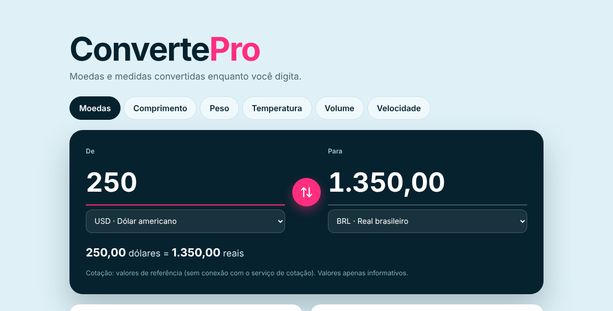

# ConvertePro — Conversor de moedas e medidas

Conversor de moedas, pesos, temperaturas e medidas com interface simples e responsiva.

🔗 **[Ver o site no ar](https://iamviniciuslima05.github.io/PROJETO-ConvertePro/)**



## Funcionalidades

- 6 categorias: **moedas**, comprimento, peso, **temperatura**, volume e velocidade
- Conversão **enquanto você digita**, nos dois sentidos
- Botão para **inverter** as unidades
- **Cotações de moedas atualizadas** por API (com valores de referência se estiver sem internet)
- Frase explicando o resultado em português
- **Tabela rápida** com valores comuns
- **Histórico** das últimas conversões
- Aceita números no formato brasileiro (1.234,56)

## Tecnologias

HTML5 · CSS3 · JavaScript · Fetch API · localStorage

## Estrutura

```
index.html
css/style.css
js/unidades.js   → tabelas de unidades e fatores
js/script.js     → conversão e interface
```

## Como rodar

Não precisa instalar nada: baixe o projeto e abra o `index.html` no navegador, ou acesse a versão publicada acima.

---
Feito por **Vinicius Lima** · [Portfólio](https://viniciuslimadev.netlify.app) · [LinkedIn](https://www.linkedin.com/in/viniciuslima25/)
